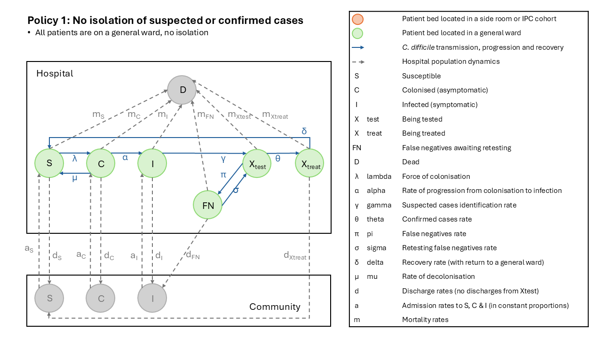
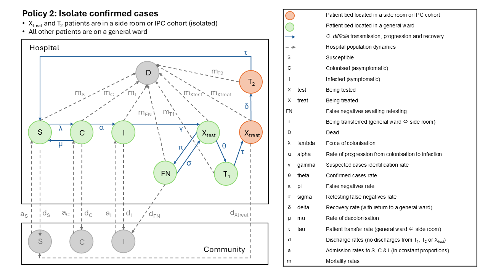
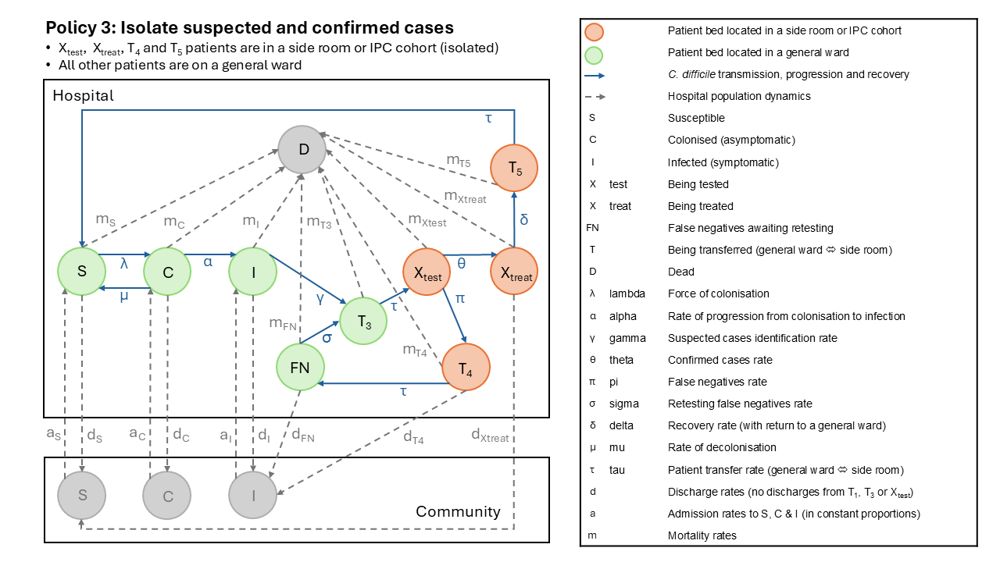

## Introduction

This script runs the ODE model for Model 1, which simulates the transmission dynamics of a healthcare-associated pathogen within a hospital setting. The model tracks the flow of patients through states of colonisation and infection, as well as the impact of testing and isolation practices on case detection, missed cases and transmission of *C. difficile* among hospital patients. It does not model testing of symptomatic patients whose symptoms are not caused by *C. difficile*, or asymptomatic patients.





 The main model compartments are:\
- **S (Susceptible)**: Not colonised or infected\
- **C (Colonised)**: Carrying the pathogen but not infected\
- **I (Infected)**: Showing symptoms caused by the pathogen\
- **Xtest (Suspected cases)**: Isolated or on a general ward, awaiting test result\
- **FN (False negatives)**: Symptomatic patients with a false negative result, not isolated, awaiting re-testing\
- **Xtreat (Confirmed cases)**: Receiving treatment, isolated in a side room (P2 and P3) or on a general ward (P1), awaiting recovery and return to a general ward, or discharge\
- **D: Dead**: cumulative count of deaths (absorbing state)

**Patient transfer states.** This version of the model accounts for patient transfer time explicitly by creating patient transfer states T1 to T5. This is expected to provide more accurate modelling results than including patient transfer time within the main rates of progression between states I, Xtest, FN, Xtreat and S.

Patient transfer time is required if patients are moved between a general ward and a side room or cohorted bed with enhanced IPC measures. For example, suspected cases may remain in their original bed on a general ward until positive test results are received, then transferred to a side room for isolation and treatment. Patient transfer time is the time they remain in their original bed while the necessary arrangement are made.

While infected patients remain on a general ward, they pose a higher risk of transmission than when they arrive in a side room. The time required for patient transfer will impact on the effectiveness of the isolation policy, and the isolation policy will modify the effect of test algorithm sensitivity on outcomes of interest, such as the number of hospital-acquired CDI cases.

The patient transfer states included in the model are: (see the transfer-state table in `README.md`):\
- **T1** (P2, general ward): confirmed case awaiting a side room for treatment (Xtest → T1 → Xtreat)\
- **T2** (P2, side room): recovered, awaiting return to a general ward (Xtreat → T2 → S)\
- **T3** (P3, general ward): suspected case awaiting a side room for testing (I or FN → T3 → Xtest)\
- **T4** (P3, side room): false negative awaiting return to a general ward (Xtest → T4 → FN)\
- **T5** (P3, side room): recovered, awaiting return to a general ward (Xtreat → T5 → S)

T1 and T3 transmit at `betaI` on a general ward, T4 at `betaI * beta_mult_isolated`, and T2 and T5 (recovered) not at all. T1, T3 and T4 die at the infected rate, T2 and T5 at the baseline rate. Only T4 has discharges (at the FN rate).

**Control variables**. The control variables for scenarios are set as vectors in section 3, and every combination is run:\
- **isolation_policy**: Which patients are isolated in a side room, from least to most isolation: P1 `"none"` (neither suspected nor confirmed cases; the reference policy), P2 `"confirmed"` (confirmed cases only) or P3 `"suspected_and_confirmed"` (suspected cases awaiting test results and confirmed cases, as recommended in best-practice guidance). P2 and P3 are compared with P1, and P3 with P2 (the incremental effect of also isolating suspected cases).\
- **prop_I_suspected** (testing coverage): Proportion of CDI cases sent for testing (must be below 100%)\
- **test_sens**: Sensitivity of the diagnostic test

Test turnaround time (`t_test_turnaround`) is a fixed parameter in `Scripts/Model1_ODE_Parameters_T.R`, but could be set as a control variable if different testing algorithms are expected to have different turnaround times.

**Scenarios modelled.** This quarto document uses the ODE function defined in "Model1_ODE_Functions_T.R" and the parameter sets defined in "Model1_ODE_Parameters_T.R" to run a grid of scenarios covering every combination of the control variables, and generates outputs including outcomes for every scenario (annual totals after a burn-in period), plots comparing the isolation policies across testing coverage and test sensitivity, rates per 10,000 patient bed-days, and time series, stabilisation checks and annual summaries for a small set of example scenarios. The outputs are saved as CSV files in a labelled subdirectory of `Outputs/Transfer_states/` and key results are also presented in tables and plots.

**Note on testing coverage.** Testing coverage (`prop_I_suspected`) is the proportion of CDI cases sent for testing: the share of patients entering I who are identified as suspected cases before they are discharged or die. Identification competes with discharge and death from I, so `prop_I_suspected = gamma / (gamma + disI + mortI)`, and the model sets the case identification rate as `gamma = prop_I_suspected * (disI + mortI) / (1 - prop_I_suspected)`. Patients move at this rate from I to Xtest, or under P3 to T3 (awaiting a side room) and then to Xtest. Transfer time is not added to `gamma`. Coverage must be below 100%, as `gamma` would be infinite at 100%, so the highest value in the grid is 99%. The mean time in I before identification, `1 / (gamma + disI + mortI)`, is therefore longer at lower coverage: with the default parameters, about 9 days at 33%, 7 days at 50% and 1.4 days at 90%. The baseline value is set from the share of hospital-onset diarrhoea patients who had ever been tested for CDI during their stay in a point-prevalence study (Mawer et al. 2019, doi 10.1016/j.jhin.2019.05.001). That is a share of *current* cases, not of all incident cases, so the model also reports its own point-prevalence equivalent (the share of current CDI cases who have ever been tested) for comparison; see section 12. Plots and tables label this control variable "Proportion of CDI cases sent for testing".

**Note on test algorithm sensitivity.** The model uses the test sensitivity (`test_sens`) and the test turnaround time to calculate two rates out of Xtest:

- confirmed case rate: `theta = test_sens / t_test_turnaround` (to Xtreat, or under P2 to T1, awaiting a side room);
- false negative rate: `pi = (1 - test_sens) / t_test_turnaround` (to FN, or under P3 to T4, awaiting return to the ward).

Neither rate includes transfer time, so the share of results that are positive, `theta / (theta + pi)`, equals `test_sens` under every policy.

**Note on missed cases when isolating awaiting the test result.** Under P3, identified patients wait in T3 (on a general ward, transmitting at `betaI`) for transfer to a side room before entering Xtest. The specimen is taken on entry to Xtest, so tests are counted when patients leave T3, not when they enter it. Patients in T3 are not discharged, but they can die before the specimen is taken: deaths in T3 of patients identified from I are counted as missed untested cases, and deaths of false negatives waiting in T3 for a retest as missed false negative cases. T3 is not split by origin, so these are apportioned by the share of the inflow to T3 from I and FN (exact at steady state); the same share splits the tests counted on leaving T3 into first tests and retests. As patients leave T3 quickly (mean `t_patient_transfer` days), few die there. The share of infected patients identified as suspected cases (leaving I) is the same under every policy, so under P3 slightly fewer are tested than under P1 and P2. False negatives discharged or dying while awaiting transfer back to the ward (T4) are counted as missed false negative cases.

### Model assumptions

Default parameter values are given in brackets; they are set in `Scripts/Model1_ODE_Parameters_T.R`.

*Pathogen and population*

- A single toxigenic strain is in circulation.
- The hospital is a single, well-mixed population: there are no separate wards or bays. The model is deterministic and its parameters don't change over time (no seasonality).
- Patients are not followed after discharge. Readmission is not modelled.

*Admissions and discharges*

- Admissions arrive at a constant rate (133/day). They do not replace discharges, so the hospital census can vary.
- Admissions are split between S, C and I in fixed proportions reflecting community prevalence (8.6% colonised, 0.2% infected, the rest susceptible). Community prevalence is fixed and isn't affected by discharges from the hospital.
- Nobody is admitted directly to Xtest or Xtreat.
- Each state has its own constant discharge rate, set by its length of stay:
  - S and C: 7 days;
  - I and FN: 14 days;
  - Xtreat: 20% of treated patients are discharged and 80% return to a general ward as susceptible, over 14 days (when isolated, those returning to the ward then wait in T2 or T5 for transfer).
- Patients awaiting a test result (Xtest) stay in hospital until the result arrives; they can't be discharged from Xtest.
- Patients awaiting transfer can't be discharged, except false negatives awaiting return to the ward (T4), who are discharged at the FN rate.
- Death rates are constant:
  - S and C share a baseline rate (0.1% risk over a 7-day stay);
  - I, Xtest and FN, and patients with CDI awaiting transfer (T1, T3, T4), die at 3× the baseline (`mortI_mult`);
  - Xtreat dies at 1.5× the baseline (`mortXtreat_mult`);
  - recovered patients awaiting transfer (T2, T5) die at the baseline rate.

*Colonisation and progression*

- Susceptible patients become colonised through:
  - background acquisition from spores in the environment, at a constant rate that doesn't depend on the number of patients in each state (β₀ = 0.002);
  - frequency-dependent transmission from colonised and infected patients (λ = β₀ + Σβₖk/N).
- Colonised and infected patients all pose a transmission risk:
  - colonised (C): 0.008;
  - infected (I) and false negatives (FN): 0.04;
  - suspected cases (Xtest): 0.04 on a general ward;
  - confirmed cases on treatment (Xtreat): 0.02 on a general ward;
  - patients awaiting transfer: as untreated infected patients in their current bed (T1 and T3 on a general ward: 0.04; T4 in a side room: 0.04 × 5%); recovered patients (T2, T5) don't transmit.
- Treatment is assumed to reduce shedding from 0.04 at the start to 0 at the end. The model uses the average over the treatment period (0.02) as a constant rate.
- Isolation in a side room reduces transmission to 5% of the general-ward value. It does not eliminate it.
- Progression from C to I is increased by antibiotic exposure among colonised patients (SCI structure, not PSCIX): the progression rate rises by a relative risk of 2 in the 37.3% of colonised patients receiving antibiotics. Without antibiotics, 50% of colonised patients progress, with a mean time to progression of 5 days.
- Colonised patients can lose colonisation without treatment (5% over 5 days).
- There is no immunity, and no recurrence or relapse. Patients who recover after treatment return to the susceptible state.
- Colonised patients are not screened, detected or decolonised.

*Case identification and testing*

- Only infected (symptomatic) patients are identified as suspected cases and tested. Patients in S and C don't develop diarrhoea that leads to testing. The test is assumed 100% specific, so there are no false positives. As a result, "faecal specimens tested" counts only tests of patients with CDI, and underestimates real testing volume.
- Testing coverage (the proportion of CDI cases sent for testing) sets the identification rate. It is the share of infected patients identified before they are discharged or die, so the mean time to identification is not set separately: it is shorter at higher coverage (see the note on testing coverage above).
- Test results arrive after a fixed turnaround time (2 days). Each test, including retests, returns a positive result with probability equal to the test sensitivity. Results of repeat tests on the same patient are independent.
- Patients with a false-negative result return to a general ward (FN), still symptomatic and transmitting. They are retested after a mean of 7 days unless they are discharged or die first.
- Confirmed cases are treated. Under P2 and P3 they are isolated; under P1 they stay on a general ward.
- Moving a patient between a general ward and a side room takes a mean of 0.5 days. Patients wait for the move in a transfer state (T1-T5) in their original bed, and leave it at rate `tau = 1 / t_patient_transfer`. Transfer time is not added to the rates of any other transition.
- Side-room capacity is unlimited.

*Outcome definitions*

- **Missed cases:** patients who leave I, FN, T3 (awaiting a side room before the specimen is taken) or T4 (false negatives awaiting return to the ward) by discharge or death without a confirmed diagnosis. Deaths while awaiting a result (in Xtest, after the specimen is taken) count as neither missed nor confirmed.
- **Hospital-onset CDI:** all in-hospital C→I progressions, i.e. patients admitted colonised plus patients colonised in hospital who progress to CDI during their stay.
- **Hospital-acquired CDI:** in-hospital C→I progressions, multiplied by the share of all colonisations that were acquired in hospital (a subset of hospital-onset CDI). This assumes patients colonised in hospital and those admitted colonised progress at the same rate.

## 1) Initial setup

Load libraries, set options, and create an output directory for this run.

The grid results from running the model (section 6) are cached in `grid_runs.rds` in the output folder. If `grid_clear_cache <- FALSE`, they are re-used on the next render if the scenario grid, fixed parameters, run settings, initial conditions and the model, parameter, validation, grid-running and post-processing functions are unchanged; otherwise the grid is re-run. Set `grid_clear_cache <- TRUE` to force a re-run.

```{r}
#| label: initial-setup
 
rm(list = setdiff(ls(), "params"))
library(tidyverse)
library(deSolve)
library(scales)
library(cowplot)
library(dplyr)
options(scipen = 1000)
output_dir <- file.path("Outputs", "Transfer_states", params$run_label)
dir.create(output_dir, showWarnings = FALSE, recursive = TRUE)

grid_clear_cache <- FALSE
```

## 2) Source parameters and functions

Source the ODE functions and parameter sets for the model. The functions include the ODE system definition, scenario running functions, and various post-processing functions for summarising and plotting results. The parameters script defines the fixed model parameters (e.g., transmission rates, recovery rates, test turnaround time) and the `make_mod_parms()` function used to build each scenario's parameter list.

```{r}
#| label: source-parameters-and-functions

source("Scripts/Model1_ODE_Functions_T.R")
source("Scripts/Model1_ODE_Parameters_T.R")
```

## 3) Set values for control variables

Set the values of each control variable as a vector. Every combination of isolation policy, testing coverage and test sensitivity is run (the scenario grid). Scenario labels combine a policy code (`P1_none`, `P2_confirmed`, `P3_susp_conf`) with the coverage and sensitivity as percentages, e.g. `P2_confirmed_cov050_sens100`.

A small set of example scenarios is taken from the grid for the time-series plots, annual summaries and outcome tables (sections 9 to 12): each isolation policy at each coverage and sensitivity setting in `example_settings`, in the order listed (by default 0%/0%, 50%/50%, 99% coverage/50% sensitivity, 50% coverage/100% sensitivity and 99%/100%; 15 scenarios). At 0% coverage nobody is tested, so the three policies give the same results; it is included as a no-testing baseline for each policy.

```{r}
#| label: set-values-for-control-variable-values 

# Control variables: every combination is run
isolation_policy <- c("none", "confirmed", "suspected_and_confirmed")   # P1, P2, P3
prop_I_suspected <- c(seq(0, 90, by = 10), 99) / 100   # testing coverage (must be < 1)
test_sens        <- seq(0, 100, by = 10) / 100

scenario_grid <- make_scenario_grid(isolation_policy, prop_I_suspected, test_sens)

# Example settings, in the order shown in sections 9 and 11 (must be values in the vectors above)
example_settings <- tribble(
  ~prop_I_suspected, ~test_sens,
  0,                 0,
  0.5,               0.5,
  0.99,              0.5,
  0.5,               1,
  0.99,              1
)

example_grid <- scenario_grid |>
  semi_join(example_settings, by = c("prop_I_suspected", "test_sens"))
if (nrow(example_grid) != length(isolation_policy) * nrow(example_settings)) {
  stop("Some example settings are not in the grid: check example_settings against the vectors above.")
}

control_parms <- scenario_grid |>
  mutate(t_test_turnaround = fixed$t_test_turnaround)
write_csv(control_parms,
          file.path(output_dir, "scenario_control_parameters.csv"))

cat("Scenario grid:", nrow(scenario_grid), "scenarios (",
    length(isolation_policy), "policies x", length(prop_I_suspected), "coverage values x",
    length(test_sens), "sensitivity values). Example scenarios:", nrow(example_grid), "\n")
```

## 4) Model settings

Set the total model run time, the time step for the ODE solver and the burn-in period. The burn-in is the period at the start of the run while the model moves from its initial conditions to steady state; it is excluded from all cumulative totals, patient-days and annual summaries, which cover the analysis period after it. The burn-in is the same for every scenario, so all totals cover the same length of time (here a 1-year burn-in and a 5-year analysis period, in a 6-year run). Sections 11 to 14 show annual totals (the analysis-period total divided by its length in years), for comparison with surveillance data. Section 8 checks that every scenario has stabilised before the end of the burn-in, and stops the render if not. Validate that the settings are appropriate (all positive, the time step smaller than the model time, and the burn-in shorter than the model time). Create a sequence of time points for the model output.

```{r}
#| label: model-settings

run_settings <- list(
  model_time = 365 * 6,
  time_step  = 0.5,
  burn_in    = 365
)
validate_run_settings(run_settings$model_time, run_settings$time_step, run_settings$burn_in)
model_time <- run_settings$model_time
time_step  <- run_settings$time_step
burn_in    <- run_settings$burn_in
analysis_years <- (model_time - burn_in) / 365
mod.t      <- seq(0, model_time, by = time_step)
```

## 5) Initial conditions

Set the initial conditions for the model states (S, C, I, Xtest, FN, Xtreat, the transfer states T1-T5, and D) at time 0. These values represent the starting point of the simulation and can be adjusted as needed for different scenarios or sensitivity analyses. The order must match the order of the derivatives returned by the ODE function (`Model1A_ODE()` in `Scripts/Model1_ODE_Functions_T.R`).

```{r}
#| label: initial-conditions

S0      <- 909
C0      <- 86
I0      <- 5
Xtest0  <- 0
FN0     <- 0
Xtreat0 <- 0
T10     <- 0
T20     <- 0
T30     <- 0
T40     <- 0
T50     <- 0
D0      <- 0
mod.init <- c(
  S      = S0,
  C      = C0,
  I      = I0,
  Xtest  = Xtest0,
  FN     = FN0,
  Xtreat = Xtreat0,
  T1     = T10,
  T2     = T20,
  T3     = T30,
  T4     = T40,
  T5     = T50,
  D      = D0
)
```

## 6) Run scenarios

Run the ODE model for every scenario in the grid using `run_scenario_grid()`. Each run is post-processed with `add_quantities()`, which multiplies each output row by the time step to give per-step flows and patient-days (rows in the burn-in, including time 0, are given zero width, so cumulative totals cover exactly the analysis period after the burn-in), and immediately summarised (parameters, final cumulative outcomes, patient-days, stabilisation and any negative values), so full time series are not kept for the whole grid.

The grid results are cached in `grid_runs.rds` in the output folder. They are re-used on the next render if the scenario grid, fixed parameters, run settings, initial conditions and the model, parameter, validation, grid-running and post-processing functions are unchanged; otherwise the grid is re-run. Set `grid_clear_cache <- TRUE` in the setup section 1) to force a re-run, or FALSE to use the cached grid results.

The grid runs in parallel on `grid_n_cores` CPU cores (default: all physical cores but one); set it to 1 to run one scenario at a time in this session.

The example scenarios are then re-run to keep their full time series, which are saved as `solution_<scenario>.csv`.

```{r}

#| label: run-scenarios

grid_cache_file  <- file.path(output_dir, "grid_runs.rds")

# Number of CPU cores used to run the grid in parallel (1 = run in this session, one at a time)
grid_n_cores <- max(1, parallel::detectCores(logical = FALSE) - 1)

grid_cache_key <- list(
  scenario_grid = scenario_grid,
  fixed         = fixed,
  run_settings  = run_settings,
  mod.init      = mod.init,
  code          = lapply(list(Model1A_ODE, make_mod_parms, prob2rate, validate_fixed_parameters,
                              validate_scenario_inputs, validate_rate_parameters, run_scenario,
                              run_scenario_grid, add_quantities, make_final_outcomes,
                              calculate_total_patient_days, stabilisation_summary,
                              find_stabilisation_day, negative_value_rows), deparse)
)

grid_cache <- if (!grid_clear_cache && file.exists(grid_cache_file)) readRDS(grid_cache_file) else NULL

if (!is.null(grid_cache) && identical(grid_cache$key, grid_cache_key)) {
  grid_runs <- grid_cache$runs
  cat("Loaded scenario grid results from", grid_cache_file, "\n")
} else {
  grid_runs <- run_scenario_grid(scenario_grid, time_step, burn_in = burn_in, n_cores = grid_n_cores)
  saveRDS(list(key = grid_cache_key, runs = grid_runs), grid_cache_file)
  cat("Ran", nrow(scenario_grid), "scenarios and saved results to", grid_cache_file, "\n")
}

# One row per scenario: control values, final cumulative outcomes and patient-days
grid_results <- make_grid_results(scenario_grid, grid_runs)

# Annual totals: every count and patient-day column divided by the length of the analysis period
grid_results_annual <- grid_results |>
  mutate(across(c(starts_with("cum_"), ends_with("_days")), \(x) x / analysis_years))

# Long format for the outcomes compared across the grid (sections 13 and 14), as annual totals, and
# differences between policies (P2 vs P1, P3 vs P1, P3 vs P2)
grid_long  <- make_grid_outcomes_long(grid_results, years = analysis_years)
grid_diffs <- make_grid_diffs(grid_long)

write_csv(grid_runs$parms,
          file.path(output_dir, "model_parameters_all_scenarios.csv"))
write_csv(grid_runs$patient_days, file.path(output_dir, "patient_days_summary.csv"))

# Example scenarios: re-run and keep full time series
example_parms <- pmap(example_grid, \(scenario, isolation_policy, prop_I_suspected, test_sens)
  make_mod_parms(isolation_policy = isolation_policy,
                 prop_I_suspected = prop_I_suspected,
                 test_sens        = test_sens,
                 scenario_label   = scenario)) |>
  set_names(example_grid$scenario)

scenario_post <- lapply(example_parms, \(p) run_scenario(p) |> add_quantities(time_step = time_step, burn_in = burn_in))

walk2(scenario_post,
      names(scenario_post),
      ~ write_csv(.x, file.path(
        output_dir, paste0("solution_", .y, ".csv")
      )))

# Patient-days for the example scenarios (all scenarios are saved in patient_days_summary.csv;
# section 12 shows them per year)
patient_days_summary <- grid_runs$patient_days |>
  filter(scenario %in% example_grid$scenario)
```

## 7) Negative values checks

Check for any negative values in the model states or flows, which may indicate numerical issues with the ODE solver or problems with the model structure. The `negative_value_rows` function identifies rows in the data frame where any state or flow has a negative value. This is checked for every scenario in the grid, and all negative rows are saved to one CSV for further investigation.

```{r}
#| label: negative_values_check

neg_combined <- grid_runs$negatives

# Output to screen
if (nrow(neg_combined) > 0) {
  knitr::kable(count(neg_combined, scenario, name = "negative_rows"),
               caption = "Scenarios with negative model output rows")
} else {
  cat("No negative values found in any of the", nrow(scenario_grid), "scenarios.\n")
}

# Save as CSV
write_csv(neg_combined, file.path(output_dir, "all_negative_rows_combined.csv"))
```

## 8) Stabilisation summary

Identify the day on which the model states stabilise for every scenario in the grid using the `stabilisation_summary` function. This function determines when the values of the states reach a steady state (i.e., change by less than a tolerance of 1e-4 per time step for a specified number of consecutive time steps). Note that the `consecutive_days` setting and output column count time steps, not days: the default of 10 is 10 half-day steps, i.e. 5 days. The full summary for all scenarios is saved as a CSV; the table shows the example scenarios. The burn-in (section 4) must be longer than the stabilisation period of every scenario, so that the totals cover steady-state behaviour only: if any scenario has not stabilised by the end of the burn-in, the render stops with an error listing those scenarios, and `burn_in` (and `model_time`) should be increased. The longest stabilisation period across the example scenarios sets the time window for the time-series plots in section 9, which therefore show the approach to steady state during the burn-in.

```{r}
#| label: stabilisation-summary

stability_all <- grid_runs$stability
write_csv(stability_all,
          file.path(output_dir, "stabilisation_summary_states_flows.csv"))

not_stabilised <- stability_all |> filter(!stabilised) |> pull(scenario)
cat(sum(stability_all$stabilised), "of", nrow(stability_all),
    "scenarios stabilised; latest stabilisation day across the grid:",
    max(stability_all$stabilisation_day, na.rm = TRUE), "\n")
if (length(not_stabilised) > 0) {
  cat("Not stabilised within the run:", paste(not_stabilised, collapse = ", "), "\n")
}

# Check the burn-in is longer than the stabilisation period of every scenario; stop if not
late_stabilisation <- stability_all |>
  filter(!stabilised | stabilisation_day >= burn_in) |>
  pull(scenario)
if (length(late_stabilisation) > 0) {
  stop(length(late_stabilisation), " scenario(s) did not stabilise before the end of the ",
       burn_in, "-day burn-in: ", paste(late_stabilisation, collapse = ", "),
       ". Increase burn_in (and model_time) in section 4.")
}
cat("All scenarios stabilised before the end of the ", burn_in, "-day burn-in (latest: day ",
    max(stability_all$stabilisation_day), ").\n", sep = "")

stability_examples <- stability_all |> filter(scenario %in% example_grid$scenario)
longest_stabilisation <- max(stability_examples$stabilisation_day, na.rm = TRUE)
knitr::kable(stability_examples, caption = "Stabilisation: model states and flows, example scenarios")
```

## 9) Time-series plots up to stabilisation

Sections 9 to 11 show results for the example scenarios that help verify the model is working as expected; sections 12 to 14 present the results for the write-up.

Plot the model states and flows over time for the example scenarios, from the start of the run up to the longest stabilisation period across the example scenarios (section 8), i.e. the approach to steady state during the burn-in. The plots show each isolation policy in a column (P1, P2, P3) and each coverage and sensitivity setting in a row, in the order set in `example_settings` (section 3). Each plot is saved as a PNG file in the output directory and shown in a tab.

```{r}
#| label: time-series-plots-save

final_outcomes         <- grid_runs$final
example_final_outcomes <- final_outcomes |> filter(scenario %in% example_grid$scenario)

# Annual totals: counts and patient-days divided by the length of the analysis period
annualise <- \(df) df |> mutate(across(c(starts_with("cum_"), ends_with("_days")), \(x) x / analysis_years))

example_annual_outcomes <- annualise(example_final_outcomes)
example_annual_bed_days <- annualise(patient_days_summary)

# Generate input data for plots
plot_long_states        <- make_plot_long_states(scenario_post, longest_stabilisation)
plot_long_bed_occupancy <- make_plot_long_bed_occupancy(scenario_post, longest_stabilisation)
plot_long_flows         <- make_plot_long_flows(scenario_post)

# Plots, in display order: file name (without .png), tab title, plot and size (cm), with one row of
# panels per setting
ts_height <- 4 + 3.5 * nrow(example_settings)
time_series_plots <- tribble(
  ~file,                               ~title,                              ~plot,                                                                                 ~width, ~height,
  "plot_states_lines_facet",           "States",                            plot_states_line(plot_long_states),                                                    16,     ts_height,
  "plot_states_lines_facet_noS",       "States (excluding S)",              plot_states_line_noS(plot_long_states),                                                16,     ts_height,
  "plot_states_area_facet",            "States (area)",                     plot_states_area(plot_long_states),                                                    16,     ts_height,
  "plot_states_area_facet_noS",        "States (area, excluding S)",        plot_states_area_noS(plot_long_states),                                                16,     ts_height,
  "plot_bed_occupancy",                "Bed occupancy",                     plot_bed_occupancy(plot_long_bed_occupancy, longest_stabilisation),                   16,     ts_height,
  "plot_flows_to_C_and_I",             "New colonisations and infections",  plot_flows_to_C_and_I(plot_long_flows, longest_stabilisation, example_final_outcomes), 16,   ts_height,
  "plot_case_ascertainment_line",      "Case ascertainment",                plot_case_ascertainment_line(plot_long_flows, longest_stabilisation),                  16,     ts_height,
  "plot_deaths_by_state_area_noS",     "Deaths by state",                   plot_deaths_by_state_area_noS(plot_long_flows, longest_stabilisation),                 16,     ts_height,
  "plot_discharges_by_state_area_noS", "Discharges by state",               plot_discharges_by_state_area_noS(plot_long_flows, longest_stabilisation),             16,     ts_height
) |>
  mutate(path = file.path(output_dir, paste0(file, ".png")))

pwalk(time_series_plots, \(path, plot, width, height, ...)
  ggsave(path, plot, width = width, height = height, dpi = 300, units = "cm"))
```

The tabs show the saved PNG files.

::: panel-tabset
```{r}
#| label: time-series-plots-tabs
#| echo: false
#| results: asis

for (i in seq_len(nrow(time_series_plots))) {
  cat("\n\n### ", time_series_plots$title[i], "\n\n", sep = "")
  cat("{width=100%}\n\n", sep = "")
}
```
:::

## 10) Annual summary tables

Create annual summary tables for each example scenario using the `make_annual_summary` function, which calculates annual totals for flow quantities and patient-days. Years are counted from the end of the burn-in (year 1 is the first year of the analysis period); the burn-in is excluded. Combine the annual summaries into a single data frame and save it as a CSV (`annual_summary_all.csv`, every year of the analysis period). As every scenario has stabilised before the end of the burn-in, each year of the analysis period is the same, so the table shows year 1 only.

```{r}
#| label: annual-summary-tables

annual_summary_all <- bind_rows(Map(make_annual_summary, scenario_post, names(scenario_post)))
write_csv(annual_summary_all,
          file.path(output_dir, "annual_summary_all.csv"))
knitr::kable(annual_summary_all |> filter(year == 1),
             caption = "Annual summary, year 1 of the analysis period, example scenarios")
```

## 11) Plots of annual summaries

Stacked bar plots of annual totals over the analysis period after the burn-in, for the example scenarios, grouped by coverage and sensitivity setting (in the order set in `example_settings`), with P1, P2 and P3 side by side within each group:

- **Colonisations by source**: hospital-acquired colonisations from background acquisition (`beta0`) and from patient-to-patient transmission (secondary colonisations) from each state (C, I, Xtest, FN, Xtreat, and the transfer states T1, T3 and T4, each shown in a lighter shade next to the state it belongs to). These are colonisations, not CDI cases. For modelling simplicity, the background acquisition rate does not depend on the number of patients in each state.
- **Faecal specimens tested**: first tests and retests of false negatives.
- **Confirmed cases**: confirmed via first test and via retest (apportioned post hoc by the share of all tests that were retests).
- **Missed cases**: untested (discharged or died in I) and false negatives (discharged or died in FN, or in T4 awaiting return to the ward).
- **Outcomes of CDI cases**: discharged untreated, shown separately for untested patients (from I) and patients with a false negative result (from FN or T4), recovered after treatment (returned to a general ward or discharged from Xtreat) and died following CDI.
- **Bed-days by bed type**: patient bed-days per year in general ward beds and in side rooms (suspected cases, isolated under P3 only, and confirmed cases, isolated under P2 and P3, combined, including patients awaiting transfer out of a side room: T2 under P2, T4 and T5 under P3). The top of each stack is total patient bed-days; divide by 365 for the average number of occupied beds.

```{r}
#| label: annual-summaries-plots

annual_plots <- tribble(
  ~file,                          ~title,                     ~plot,
  "plot_colonisations_by_source", "Colonisations by source",  plot_colonisation_sources_bar(example_annual_outcomes),
  "plot_testing_bar",             "Faecal specimens tested",  plot_testing_bar(example_annual_outcomes),
  "plot_case_confirmation_bar",   "Confirmed cases",          plot_case_confirmation_bar(example_annual_outcomes),
  "plot_missed_cases_bar",        "Missed cases",             plot_missed_cases_bar(example_annual_outcomes),
  "plot_case_outcomes_bar",       "Outcomes of CDI cases",    plot_case_outcomes_bar(example_annual_outcomes),
  "plot_bed_days_bar",            "Bed-days by bed type",     plot_bed_days_bar(example_annual_bed_days)
) |>
  mutate(path = file.path(output_dir, paste0(file, ".png")))

pwalk(annual_plots, \(path, plot, ...)
  ggsave(path, plot, width = 20, height = 10, dpi = 300, units = "cm"))
```

The tabs show the saved PNG files.

::: panel-tabset
```{r}
#| label: annual-summaries-plots-tabs
#| echo: false
#| results: asis
for (i in seq_len(nrow(annual_plots))) {
  cat("\n\n### ", annual_plots$title[i], "\n\n", sep = "")
  cat("{width=100%}\n\n", sep = "")
}
```
:::

## 12) Research question outcomes

Sections 12 to 14 present the results for the write-up (sections 9 to 11 are verification checks on the example scenarios).

**Research questions**

The model is designed to focus on diagnostic testing of hospital patients with CDI. It does not include testing of symptomatic patients without CDI, or screening asymptomatic patients.

It can be used to quantify the effect of changes in testing algorithm sensitivity for different levels of testing coverage for symptomatic hospital patients with CDI and different hospital policies on location of suspected cases awaiting test results and/or confirmed cases while receiving treatment (i.e. on a general ward versus isolated in a side-room). The value of other parameters, such as test turnaround time and time required for patient transfers between general ward and side room beds can be varied for sensitivity analysis.

Differences in total and hospital-onset CDI cases between scenarios are driven entirely by differences in hospital-acquired CDI because:

a)  the model uses fixed admission rates and fixed prevalence of colonisations and infections among admitted patients, and
b)  testing and isolation affect only infected patients, so progression to CDI among patients admitted colonised is the same in every scenario.

Where outcomes are described as estimates, they are calculated using the shares of patient flows from one state to multiple states, or from multiple states to one state. For example:

a)  cases confirmed through re-testing are estimated by apportioning the flow from Xtest to Xtreat by the share of flows into Xtest that come from FN (retests), rather than from I (first tests);
b)  hospital-acquired CDI is estimated by apportioning the flow from C to I by the share of all flows into C that come from S (colonisation in hospital), rather than from admissions to C.

**Outcomes of interest**

1)  Case ascertainment:
    a)  the total number of incident CDI cases (to include patients that were colonised on admission that progress to CDI during their hospital stay, patients admitted with CDI and patients that become colonised and progress to CDI during their hospital stay);
    b)  the number of missed CDI cases, i.e. those that are discharged or die following progression to infection that either did not have a specimen tested for CDI or received a false negative test result;
    c)  the proportion of CDI cases in hospital that have ever been tested for CDI, as a point prevalence at model stabilisation (for comparison with point-prevalence studies such as Mawer et al. 2019);
    d)  the number and proportion of incident CDI cases amongst hospital patients that are confirmed through diagnostic testing;
    e)  the estimated number and proportion of incident CDI cases that are confirmed through re-testing following a false-negative test result (delayed diagnosis).
2)  Transmission of *C. difficile*:
    a)  the estimated number of hospital-acquired infections (patients that become colonised and progress to CDI during their hospital stay); and
    b)  the difference in prevalence of colonisation and infection amongst discharged versus admitted patients.
3)  Hospital resource use:
    a)  total hospital bed occupancy, reflecting any impacts on bed pressure and average patient length of stay;
    b)  general ward bed occupancy;
    c)  required side room bed occupancy;
    d)  the proportion of hospital bed occupancy that is required for patient isolation in a side room;
    e)  the number of faecal specimens collected and tested for CDI;
    f)  the number of faecal specimens collected and tested for CDI per CDI case confirmed;
    g)  the number of confirmed cases that are started on treatment for CDI (equal to 1d).
4)  CDI case outcomes:
    a)  the number of incident CDI cases that are treated and recover (then either returned to a general ward or discharged);
    b)  the number of incident CDI cases that are discharged untreated;
    c)  the number of incident CDI cases that die in hospital (with no specimen sent for testing, awaiting a test result, awaiting re-testing following a false negative test result, or during treatment);
    d)  number of CDI-attributable deaths in hospital (accounting for deaths that may have occurred due to other causes).

**Outputs required for cost effectiveness analysis (CEA) or cost utility analysis (CUA)**

CEA involves calculation of Incremental Cost Effectiveness Ratios (ICERs) for specific changes in testing or isolation policy, that allows comparison of multiple outcomes within a single metric, cost per avoided hospital-acquired CDI case. For cost-utility analysis the metric is £ cost per avoided QALY loss. CEA and CUA would require information on the hospital resource costs (specimen collection and testing, side room and general ward patient care, CDI treatment). CUA would require patient welfare values for untreated, treated/recovered CDI cases and deaths from CDI (discounted QALY losses).

The CEA/CUA would not take account of outcomes for CDI cases that occur in the community, as a result of:

a)  discharged colonisations that progress to infection;
b)  onwards transmission from discharged colonised or infected patients.

Model outcomes required for calculation of an ICER for a change in testing or isolation are shown in the tables below.

**ICER numerator, change in costs**

| Model outcome | ICER numerator |
|----|----|
| Number of patient days on a general ward | × general ward care, cost per day |
| Number of patient days in a side room | × side room care, cost per day |
| Number of confirmed CDI cases | × CDI antimicrobial therapy, cost per course of treatment |
| Number of faecal specimens tested for CDI | × specimen collection and testing, cost per specimen |

**ICER denominator, avoided hospital-acquired CDI case**

| Model outcome                         | ICER denominator |
|---------------------------------------|------------------|
| Number of hospital-acquired CDI cases |                  |

**ICER denominator, avoided QALY loss**

| Model outcome                          | ICER denominator                  |
|----------------------------------------|-----------------------------------|
| Number of treated, recovered CDI cases | × QALY loss for treated cases     |
| Number of untreated, discharged cases  | × QALY loss for untreated cases   |
| Number of CDI-attributable deaths      | × discounted QALY loss for deaths |

Extending the model to include probabilistic analysis, with distributions for uncertain parameters would allow value of information analysis.

**Research question outcomes table**

The table shows the outcomes of interest for the example scenarios, numbered as above, as annual totals after the burn-in, followed by the model outcomes required for the ICER numerator and denominator. Notes:

- The proportions of incident CDI cases confirmed (1d) and missed (1b) do not sum to 1: the gap is mainly deaths while awaiting a test result (tested, but neither confirmed nor missed).
- Differences in prevalence (2b) are discharge minus admission prevalence in percentage points (pp); a positive value indicates the hospital is a net source.
- CDI-attributable deaths (4d) are deaths following CDI that would not have occurred at the baseline death rate: deaths of untreated CDI patients (I, Xtest, FN, and T1, T3 and T4 awaiting transfer) × (1 − 1/`mortI_mult`) plus deaths of treated patients (Xtreat) × (1 − 1/`mortXtreat_mult`). Recovered patients awaiting transfer (T2, T5) die at the baseline rate and are not CDI deaths.
- Specimens tested per confirmed case (3f) is shown as "-" where no cases are confirmed (0% coverage or sensitivity).

The effect of the isolation policies across testing coverage and test sensitivity is shown in section 13, and the change in outcomes from improving test sensitivity, for each policy, in section 14.

Final cumulative outcomes for every scenario in the grid (totals over the `r analysis_years`-year analysis period after the burn-in) are saved as CSVs:

- `final_outcomes_all.csv`: all cumulative outcomes from `make_final_outcomes`, joined to the control values and patient-days, with the derived outcomes (proportions, prevalence differences, specimens per confirmed case)
- `research_outcomes_all.csv`: the research question outcomes table (below), per year, for every scenario
- `grid_key_outcomes.csv` and `grid_key_outcome_differences.csv`: the outcomes compared in sections 13 and 14 (counts as annual totals), and their differences between policies, in long format
- `grid_rates.csv`: rates per 10,000 patient bed-days (CDI, hospital-onset CDI, hospital-acquired CDI, faecal specimens tested), the proportion of patient bed-days in a side room, the proportion of CDI cases missed, and missed cases per year by origin, for every scenario, in long format

```{r}
#| label: research-questions-outcomes-table

write_csv(grid_results, file.path(output_dir, "final_outcomes_all.csv"))
write_csv(grid_long,    file.path(output_dir, "grid_key_outcomes.csv"))
write_csv(grid_diffs,   file.path(output_dir, "grid_key_outcome_differences.csv"))
write_csv(make_grid_rates(grid_results, analysis_years) |>
            make_grid_outcomes_long(spec = rate_spec),
          file.path(output_dir, "grid_rates.csv"))

# Research question outcomes, per year
research_outcomes <- make_research_outcomes_table(example_annual_outcomes, example_annual_bed_days,
                                                  per_year = TRUE)
write_csv(research_outcomes, file.path(output_dir, "research_outcomes.csv"))
write_csv(make_research_outcomes_table(annualise(final_outcomes), annualise(grid_runs$patient_days),
                                       per_year = TRUE),
          file.path(output_dir, "research_outcomes_all.csv"))
knitr::kable(research_outcomes, caption = "Research question outcomes and ICER inputs per year after the burn-in, example scenarios")
```

**Testing coverage compared with point-prevalence studies.** Testing coverage is the share of *incident* CDI cases sent for testing before discharge or death (calculated as suspected cases identified / incident CDI cases, which equals `prop_I_suspected` at steady state). Point-prevalence studies such as Mawer et al. (2019) report the share of *current* cases who have ever been tested during their stay. The model equivalent is the share of CDI patient-days spent in a tested state, averaged over the analysis period. The specimen is taken on entry to Xtest, so the tested states are Xtest, FN, Xtreat, T1 and T4, plus the share of T3 (awaiting a side room under P3) that came from FN; patients in I, and those in T3 who came from I, have not yet been tested. T3 is not split by origin, so its share from FN is estimated from the inflows to T3 (exact at steady state). The two differ because tested and untested cases stay in hospital for different lengths of time, and the point-prevalence share also depends on the policy and test sensitivity. The table shows both, at the test sensitivity set below.

```{r}
#| label: coverage-point-prevalence
coverage_check_sens <- 0.5   # must be a value in the test_sens vector

coverage_check <- grid_results |>
  filter(abs(test_sens - coverage_check_sens) < 1e-6) |>
  mutate(policy = isolation_policy_labels[as.character(isolation_policy)]) |>
  select(prop_I_suspected, prop_sent_for_testing, policy, prop_current_CDI_tested) |>
  pivot_wider(names_from = policy, values_from = prop_current_CDI_tested) |>
  # prop_sent_for_testing is the same under every policy; keep the first
  group_by(prop_I_suspected) |>
  summarise(across(everything(), \(x) x[!is.na(x)][1]), .groups = "drop")
write_csv(coverage_check, file.path(output_dir, "coverage_point_prevalence.csv"))

knitr::kable(
  coverage_check |>
    mutate(across(everything(), \(x) scales::percent(x, accuracy = 0.1))) |>
    rename("Testing coverage (prop_I_suspected)" = prop_I_suspected,
           "CDI cases sent for testing (% of incident cases)" = prop_sent_for_testing),
  caption = paste0("Testing coverage and the share of current CDI cases ever tested (point ",
                   "prevalence) under each policy, at ", scales::percent(coverage_check_sens),
                   " test sensitivity")
)
```

## 13) Outcomes by testing coverage and test sensitivity

Compare the three isolation policies across every combination of testing coverage and test sensitivity in the grid, for the research question outcomes 1a, 1b, 1c, 1d (proportion), 1e (proportion), 2a, 2b, 3a, 3c, 3e and 3f (set by the `plot` column of `grid_outcome_spec` in `Scripts/Model1_ODE_Functions_T.R`). Counts are annual totals over the analysis period (the `r analysis_years`-year total after a `r burn_in`-day burn-in, divided by `r analysis_years`); proportions and prevalence differences are over the whole analysis period. The other research question outcomes are tabulated in section 12 and saved in `final_outcomes_all.csv`.

**Note on total and hospital-acquired CDI cases.** Differences in total CDI cases (1a) between scenarios are driven entirely by differences in hospital-acquired CDI cases (2a), so the difference plots for 1a and 2a are identical. Admissions arrive at a fixed rate, so patients admitted with CDI (`r scales::comma(round(grid_results_annual$cum_admitted_infected[1]))` per year) and patients admitted colonised are the same in every scenario. Testing and isolation act only on infected patients, so they do not change how colonised patients progress, lose colonisation or leave hospital, and progressions to CDI among patients admitted colonised are also the same in every scenario (`r scales::comma(round(grid_results_annual$cum_infected_in_hospital[1] - grid_results_annual$cum_hospital_attributable_I[1]))` per year). Total and hospital-onset CDI cases therefore differ from hospital-acquired CDI cases by a constant.

Each tab shows one outcome, as:

1.  **Line plot**: outcome against test sensitivity, with one line for each of 0%, 20%, 40%, 60%, 80% and 99% testing coverage (`grid_line_coverage`), and the same y axis for each isolation policy.
2.  **Differences from P1**: the same, for P2 minus P1 and P3 minus P1 at the same testing coverage and test sensitivity, placed under P2 and P3 in the line plot above (the space under P1 is left empty). A negative value means less of the outcome than with no isolation. This shows the effect of each isolation policy more clearly than the totals, which are dominated by the differences across coverage.
3.  **Heatmaps**: test sensitivity (x) by testing coverage (y), for every grid value. The top row shows the outcome under each policy, with one colour scale shared across the policies (yellow lowest, purple highest). The bottom row shows the differences P2 minus P1 and P3 minus P1, under P2 and P3 (the space under P1 is left empty), with one colour scale shared across both (yellow largest negative difference, purple largest positive difference).

Differences between policies, including P3 vs P2 (the incremental effect of also isolating suspected cases), are saved in `grid_key_outcome_differences.csv`.

At 0% testing coverage no patients are tested, so test sensitivity has no effect and the line is flat.

**Note on very low test sensitivity.** At low sensitivity (roughly 10% or below), testing can increase CDI, hospital-acquired CDI, missed cases and deaths compared with no testing. Most tested patients receive a false negative result and return to the general ward (FN), where they continue to transmit at `betaI`. They are retested after `t_wait_retest` days, which is sooner than the typical time to discharge, so many cycle repeatedly between FN and awaiting a result (Xtest). There is no discharge from Xtest, so each retest also keeps them in hospital for longer. These patients are held back from treatment (and, for confirmed cases, isolation), and are kept infectious in hospital for longer than untested patients. This is intended: it shows the effect of testing with a low-sensitivity assay.

```{r}
#| label: note-values
#| include: false
# Helpers for the figures quoted in the notes in sections 13 and 14 (calculated from the grid as
# annual totals, so they stay correct if parameters change)
P1 <- "none"; P2 <- "confirmed"; P3 <- "suspected_and_confirmed"
# Highest testing coverage in the grid (coverage must be below 100%), used for the figures below
max_cov <- max(grid_results$prop_I_suspected)
on_grid <- function(df, pol, cov, sens) {
  df$isolation_policy == pol & abs(df$prop_I_suspected - cov) < 1e-6 & abs(df$test_sens - sens) < 1e-6
}
# Annual value of a final outcome column for one scenario
gval <- function(var, pol, cov, sens) grid_results_annual[[var]][on_grid(grid_results_annual, pol, cov, sens)]
# Share of test results that are positive, theta / (theta + pi + mortXtest)
pos_share <- function(pol, sens, cov = max_cov) {
  p <- grid_runs$parms[on_grid(grid_runs$parms, pol, cov, sens), ]
  p$theta / (p$theta + p$pi + p$mortXtest)
}
n0 <- function(x) scales::comma(round(x))
n0p <- function(x) scales::comma(round(x), style_positive = "plus")
pc <- function(x) scales::percent(x, accuracy = 1)

# Missed CDI cases per year at the highest coverage: P3 minus P1 by sensitivity
miss_gap <- tibble(sens = sort(unique(grid_results$test_sens))) |>
  mutate(gap = map_dbl(sens, \(s) gval("cum_total_missed_cases", P3, max_cov, s) -
                                  gval("cum_total_missed_cases", P1, max_cov, s)))
miss_trough_sens <- miss_gap$sens[which.min(miss_gap$gap)]
# Lowest sensitivity at which P3 has more missed cases than P1 (NA if it never does)
miss_cross_sens  <- if (any(miss_gap$gap > 0)) min(miss_gap$sens[miss_gap$gap > 0]) else NA_real_
```

**Note on differences between isolation policies at low test sensitivity.** At 0% testing coverage, nobody is identified as a suspected case, so no patients reach Xtest or Xtreat and the three policies give identical results. With coverage above 0% and low sensitivity, there are more CDI cases (and hospital-acquired CDI and colonisations) under P1 and P2 than under P3. This is not because infected patients stay longer in I: identified patients leave I sooner than without testing (I patient-days fall sharply). The extra transmission happens after they leave I, while they cycle between awaiting a result (Xtest) and false negatives on the ward (FN):

- Under P1 and P2, suspected cases wait for their result on a general ward and transmit at the full `betaI`. Under P3 they wait in a side room and transmit at `betaI * beta_mult_isolated`. With repeated retesting, patients spend many days in Xtest, so this difference drives most of the gap: at `r pc(max_cov)` coverage and 0% sensitivity, colonisations from Xtest are about `r n0(signif(gval("cum_colonised_from_Xtest", P1, max_cov, 0), 2))` per year under P1 and P2 and about `r n0(signif(gval("cum_colonised_from_Xtest", P3, max_cov, 0), 2))` under P3.
- From about 10% sensitivity, some cases are confirmed. P1 is then higher than P2, because confirmed cases (Xtreat) are treated on a general ward and transmit at `betaXtreat` rather than `betaXtreat * beta_mult_isolated`.

**Note on missed CDI cases** (tab 1b, Missed CDI cases). The figures below are per year, at `r pc(max_cov)` testing coverage; see also the note on missed cases in the introduction.

- **Line plot: more missed cases under P1 and P2 at low sensitivity.** At low sensitivity most missed cases are false negatives, and P1 and P2 have more than P3 because there are more CDI cases to miss, as suspected cases wait for their result on a general ward (see the note above): at 0% sensitivity, there are `r n0(gval("cum_total_infected_incidence", P1, max_cov, 0) - gval("cum_total_infected_incidence", P3, max_cov, 0))` more CDI cases per year under P1 and P2 than under P3. The share of results that are positive is the same under every policy (equal to the test sensitivity; see the note on test sensitivity in the introduction).
- **Line plot: P3 compared with P1 at high sensitivity.** `r if (is.na(miss_cross_sens)) "P3 has fewer missed cases than P1 at every test sensitivity. The share of CDI cases missed untested (discharged or dying in I, plus the few dying in T3 under P3) is almost the same under every policy, as transfer time is not added to the case identification rate, so P3 keeps the advantage of fewer CDI cases even when false negatives are rare." else paste0("From ", pc(miss_cross_sens), " sensitivity, P3 has more missed cases than P1, as false negatives become rare.")`
- **The difference plots.** The P3 vs P1 difference is most negative at `r pc(miss_trough_sens)` sensitivity (`r n0p(min(miss_gap$gap))` per year). As sensitivity rises, all three policies confirm more cases, the pool of false negatives shrinks for everyone and the differences narrow (`r n0p(miss_gap$gap[which.max(miss_gap$sens)])` per year at `r pc(max(miss_gap$sens))` sensitivity). At 0% coverage nobody is tested, so the differences are zero.

```{r}
#| label: grid-plots-save

# Outcomes shown in the tabs (plot = TRUE in grid_outcome_spec)
tab_outcomes <- grid_outcome_spec |>
  filter(plot) |>
  mutate(
    lines        = file.path(output_dir, paste0("grid_lines_", variable, ".png")),
    diff_lines   = file.path(output_dir, paste0("grid_lines_diff_", variable, ".png")),
    heatmap      = file.path(output_dir, paste0("grid_heatmap_", variable, ".png"))
  )

# Save the grid plots to files
for (i in seq_len(nrow(tab_outcomes))) {
  v <- tab_outcomes$variable[i]
  ggsave(tab_outcomes$lines[i], plot_grid_outcome_lines(grid_long, v),
         width = 24, height = 10, dpi = 300, units = "cm")
  ggsave(tab_outcomes$diff_lines[i], plot_grid_diff_lines(grid_diffs, v),
         width = 24, height = 10, dpi = 300, units = "cm")
  ggsave(tab_outcomes$heatmap[i], plot_grid_heatmaps_with_diffs(grid_long, grid_diffs, v),
         width = 24, height = 22, dpi = 300, units = "cm", bg = "white")
}
```

The tabs show the saved PNG files.

::: panel-tabset
```{r}
#| label: grid-plots-tabs
#| echo: false
#| results: asis
for (i in seq_len(nrow(tab_outcomes))) {
  cat("\n\n### ", tab_outcomes$label[i], "\n\n", sep = "")
  for (path in c(tab_outcomes$lines[i], tab_outcomes$diff_lines[i],
                 tab_outcomes$heatmap[i])) {
    cat("{width=100%}\n\n", sep = "")
  }
}
```
:::

## 14) Change in outcomes due to increasing test sensitivity

For each outcome compared across the grid in section 13 except 1c (a point prevalence, shown in section 13 only), the change from increasing test sensitivity from `sens_from` to `sens_to` (set below; both must be values in the grid), reported separately for each isolation policy (P1, P2 and P3), at the same testing coverage:

> avoided = value at `sens_from` − value at `sens_to` (counts per year, and reductions in the prevalence differences and in specimens tested per confirmed case; a negative value is an increase)
>
> additional side-room patient bed-days = value at `sens_to` − value at `sens_from` (more cases are confirmed and isolated with the better test; a negative value is a decrease)
>
> change in the proportion of CDI cases confirmed (1d) or confirmed via retest (1e) = value at `sens_to` − value at `sens_from`, in percentage points

The changes in total CDI cases (1a) and hospital-acquired CDI cases (2a) are identical (see the note in section 13). The outcomes reported are set by the `gain` column of `grid_outcome_spec`, and how each is reported by `sensitivity_gain_spec`, in `Scripts/Model1_ODE_Functions_T.R`. Each tab shows a table for 0%, 20%, 40%, 60%, 80% and 99% testing coverage, and a chart for every testing coverage value in the grid (0% to 99%). At 0% coverage nobody is tested, so nothing changes. All values are saved as `sensitivity_gain_<from>_to_<to>.csv`.

```{r}
#| label: sensitivity-gain-save
sens_from <- 0.5
sens_to   <- 0.8

sensitivity_gain <- make_sensitivity_gain(grid_long, sens_from, sens_to)
write_csv(sensitivity_gain,
          file.path(output_dir, sprintf("sensitivity_gain_%03d_to_%03d.csv",
                                        round(100 * sens_from), round(100 * sens_to))))

gain_plot_files <- grid_outcome_spec |>
  filter(gain) |>
  mutate(path = file.path(output_dir, sprintf("sensitivity_gain_%03d_to_%03d_%s.png",
                                              round(100 * sens_from), round(100 * sens_to), variable)))

for (i in seq_len(nrow(gain_plot_files))) {
  ggsave(gain_plot_files$path[i],
         plot_sensitivity_gain(sensitivity_gain, gain_plot_files$variable[i], sens_from, sens_to),
         width = 18, height = 12, dpi = 300, units = "cm")
}
```

::: panel-tabset
```{r}
#| label: sensitivity-gain-tabs
#| echo: false
#| results: asis
for (i in seq_len(nrow(gain_plot_files))) {
  v <- gain_plot_files$variable[i]
  cat("\n\n### ", gain_plot_files$label[i], "\n\n", sep = "")
  cat(knitr::kable(make_sensitivity_gain_table(sensitivity_gain, v), format = "pipe", align = "r",
                   caption = sensitivity_gain_title(v, sens_from, sens_to)),
      sep = "\n")
  cat("\n\n{width=80%}\n\n", sep = "")
}
```
:::

```{r}
#| label: gain-note-values
#| include: false
# Figures for the note below, per year at the highest coverage: change from sens_from to sens_to
# (negative = fewer)
chg  <- function(var, pol) gval(var, pol, max_cov, sens_to) - gval(var, pol, max_cov, sens_from)
gain <- function(var, pol) {
  sensitivity_gain$gain[sensitivity_gain$outcome == var & sensitivity_gain$isolation_policy == pol &
                          abs(sensitivity_gain$prop_I_suspected - max_cov) < 1e-6]
}
pos_gain <- function(pol) pos_share(pol, sens_to) - pos_share(pol, sens_from)
pp <- function(x) paste0("+", round(100 * x), " points")
# Policies ordered by the amount avoided (largest first), e.g. "P2, then P3, then P1"
gain_order <- function(var) {
  pols <- c(P1 = P1, P2 = P2, P3 = P3)
  g <- vapply(pols, \(p) gain(var, p), numeric(1))
  paste(names(sort(g, decreasing = TRUE)), collapse = ", then ")
}
```

**How much improving test sensitivity helps depends on the isolation policy.**

With the default parameters, improving test sensitivity avoids most hospital-acquired CDI cases under `r gain_order("cum_hospital_attributable_I")`, and most missed CDI cases under `r gain_order("cum_total_missed_cases")`. Better sensitivity mostly helps by giving fewer false negative results: fewer patients cycle between awaiting a result (Xtest) and false negatives on the ward (FN), and more are confirmed and treated sooner. The share of results that are positive equals the test sensitivity under every policy, so it rises by the same amount (`r pc(pos_share(P1, sens_from))` to `r pc(pos_share(P1, sens_to))`) under each; the differences between policies come from where each group of patients is cared for. The figures below are per year at `r pc(max_cov)` testing coverage, for an increase from `r pc(sens_from)` to `r pc(sens_to)` sensitivity.

- **Hospital-acquired CDI cases avoided** (P1 `r n0(gain("cum_hospital_attributable_I", P1))`, P2 `r n0(gain("cum_hospital_attributable_I", P2))`, P3 `r n0(gain("cum_hospital_attributable_I", P3))`) follow the hospital-acquired colonisations avoided (P1 `r n0(-chg("cum_colonised_in_hospital", P1))`, P2 `r n0(-chg("cum_colonised_in_hospital", P2))`, P3 `r n0(-chg("cum_colonised_in_hospital", P3))`).
  - *P2*: suspected cases wait for their result on a general ward, so fewer retests mean fewer days in Xtest on the ward (colonisations from Xtest `r n0p(chg("cum_colonised_from_Xtest", P2))`) and as FN (`r n0p(chg("cum_colonised_from_FN", P2))`). The extra confirmed cases are isolated after a short wait on the ward (T1), so they add little transmission (colonisations from Xtreat `r n0p(chg("cum_colonised_from_Xtreat", P2))`, from T1 `r n0p(chg("cum_colonised_from_T1", P2))`).
  - *P1* gains as much as P2 from fewer days in Xtest (`r n0p(chg("cum_colonised_from_Xtest", P1))`) and as FN (`r n0p(chg("cum_colonised_from_FN", P1))`), but the extra confirmed cases are treated on a general ward and transmit at `betaXtreat`, adding `r n0(chg("cum_colonised_from_Xtreat", P1))` colonisations from Xtreat and offsetting much of the gain.
  - *P3*: suspected cases are already isolated, so less time in Xtest saves little (`r n0p(chg("cum_colonised_from_Xtest", P3))`), and the gain comes mainly from fewer days as FN (`r n0p(chg("cum_colonised_from_FN", P3))`) and waiting on the ward for a side room before retesting (T3, `r n0p(chg("cum_colonised_from_T3", P3))`). P3 also starts from fewer cases (`r n0(gval("cum_hospital_attributable_I", P3, max_cov, sens_from))` hospital-acquired CDI cases per year at `r pc(sens_from)` sensitivity, against `r n0(gval("cum_hospital_attributable_I", P1, max_cov, sens_from))` under P1 and `r n0(gval("cum_hospital_attributable_I", P2, max_cov, sens_from))` under P2).
- **Missed CDI cases avoided** (P1 `r n0(gain("cum_total_missed_cases", P1))`, P2 `r n0(gain("cum_total_missed_cases", P2))`, P3 `r n0(gain("cum_total_missed_cases", P3))`) are almost all false negatives discharged or dying in FN, T4 or T3 (P1 `r n0p(chg("cum_missed_false_negative_cases", P1))`, P2 `r n0p(chg("cum_missed_false_negative_cases", P2))`, P3 `r n0p(chg("cum_missed_false_negative_cases", P3))`). Missed untested cases (from I) barely change, as sensitivity does not affect who is tested. The amounts broadly follow the number of false negatives at risk at `r pc(sens_from)` sensitivity, and are similar under P2 and P3 (P1 `r n0(gval("cum_missed_false_negative_cases", P1, max_cov, sens_from))`, P2 `r n0(gval("cum_missed_false_negative_cases", P2, max_cov, sens_from))`, P3 `r n0(gval("cum_missed_false_negative_cases", P3, max_cov, sens_from))` per year).

In short, improving sensitivity matters most where suspected cases wait on a general ward and confirmed cases are isolated (P2). Where suspected cases are already isolated (P3), isolation already prevents much of the transmission that better sensitivity would avoid; where confirmed cases stay on a general ward (P1), the extra confirmed cases offset much of the gain.

## End of script
